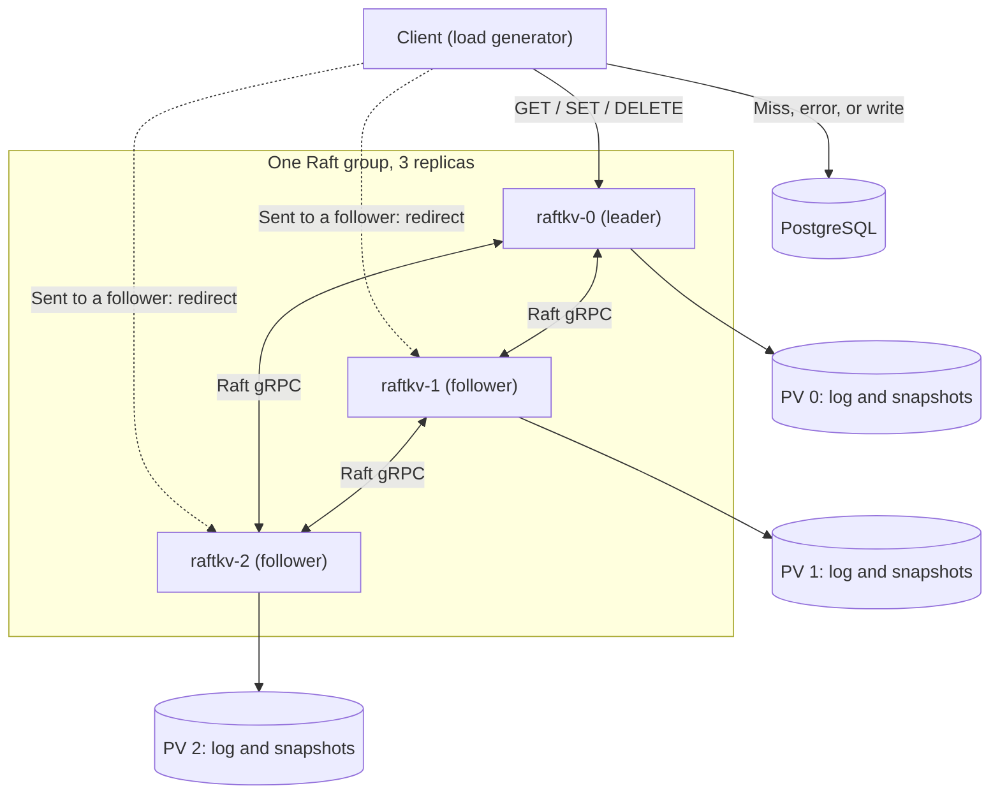
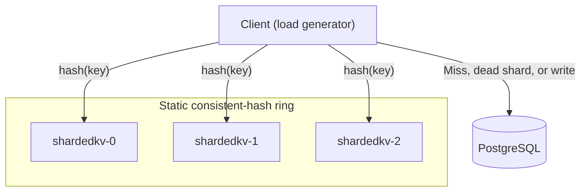
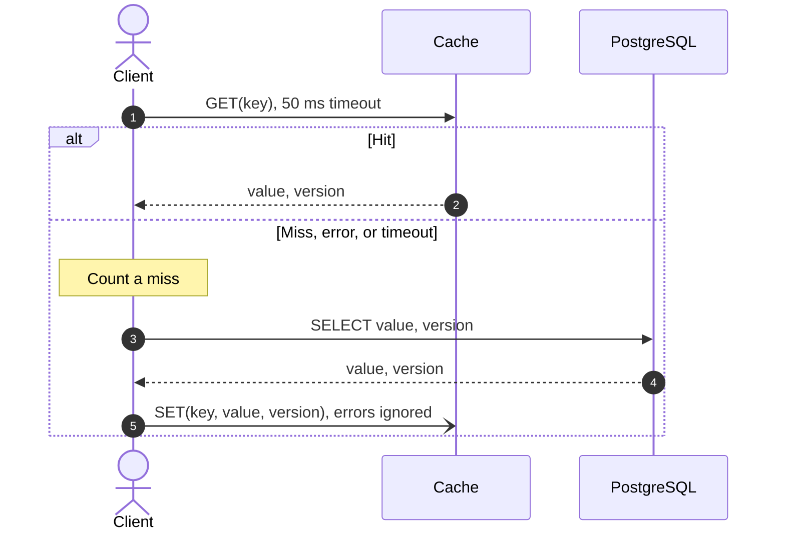
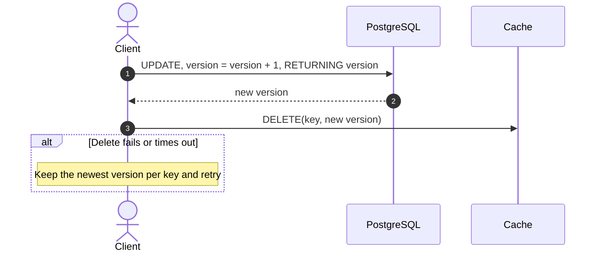
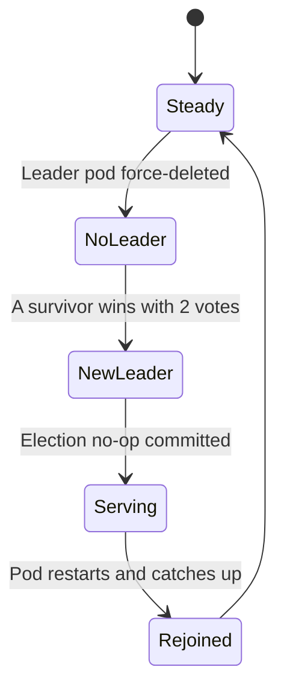
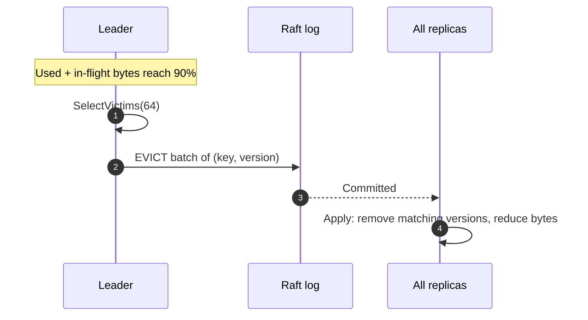

# [Design Doc] raftkv and shardedkv Under Node Failure

## 1. Scope and Terms

This document designs two cache systems, compared in front of the same
PostgreSQL setup:

- **System A (`raftkv`):** one Raft group with 3 full replicas.
- **System B (`shardedkv`):** 3 independent shards with no replication.

**Attribution.** The Raft core is the work of the authors of the upstream
library (Go module `github.com/jathurchan/raft`). This project's work is the
`raftkv` service, the eviction layer, `shardedkv`, the Kubernetes deployment,
and the benchmark harness. Fixes sent upstream (§3) and the library's end-to-end
suite are credited as contributions to the library, not as authorship of its
Raft core.

**Upstream first.** Problems in the Raft library are fixed in the library rather
than hidden in `raftkv`. That improves it for every user, and keeps the
benchmark measuring Raft instead of a workaround.

**Terms**

| **Term**       | **Meaning**                                                                                                             |
| -------------- | ----------------------------------------------------------------------------------------------------------------------- |
| Cache-aside    | The client checks the cache, reads the database on a miss, then fills the cache                                         |
| Quorum         | A majority of nodes: 2 of 3                                                                                             |
| Election       | The period when Raft nodes choose a new leader                                                                          |
| ReadIndex      | A way to serve up-to-date reads: confirm leadership with a quorum, then wait until local state reaches the commit point |
| Tombstone      | A small record that a key was deleted at a given version                                                                |
| Open-loop load | Requests are sent at a fixed rate, regardless of how fast earlier ones finish                                           |

---

## 2. Architecture

### 2.1 System A: `raftkv`



- **Membership:** `Config.Peers` lists all 3 nodes, including the node itself.
  Quorum is 2. Membership is fixed at construction.
- **Node startup:** build with `NewRaftBuilder` (`WithConfig`, `WithApplier`,
  `WithStorage`, `WithLogger`, `WithMetrics`), create the gRPC network manager
  with the node as its handler, call `SetNetworkManager`, then `Start`. A
  goroutine calls `Tick` every 100 ms until shutdown.
- **State machine:** `raftkv` implements `Applier` (`Apply`, `Snapshot`,
  `RestoreSnapshot`). `Apply` is the only path that changes cache state. It
  ignores indexes already applied, so replay after a restart is safe.
- **`ApplyChannel`:** kept drained, but not used for state changes (U8 in §3).
- **Writes:** request goroutines call `Propose` directly, which requires U1 and
  U7 in §3. `SET`, `DELETE`, and `EVICT` are commands in the log. A client write
  is acknowledged after `Apply` runs on the leader.
- **Reads:** the leader runs ReadIndex as in §6.
- **Persistence:** log and snapshots live on a persistent volume, with fsync on
  (`SyncOnAppend: true`). A restarted node restores its snapshot, then reapplies
  log entries as the leader's commit index reaches it.
- **Snapshots:** `SnapshotThreshold` is 100,000 entries. `Snapshot` copies entry
  references while `Apply` is blocked and encodes outside that lock; stored
  values are immutable. Snapshot start and end are logged so overlap with a kill
  is visible.
- **Snapshot transfer:** `MaxSnapshotChunkSize` is set to 4 MiB (U6 in §3),
  since a full 64 MiB snapshot exceeds the 16 MiB gRPC default. Chunking is off
  by default in the library.
- **Library version:** `raftkv` pins one library commit that contains every fix
  in §3. Until the review stack merges, that commit comes from `dev`. Every
  benchmark result records it.

### 2.2 System B: `shardedkv`



- Each key lives on exactly one shard. The ring has 3 members and 256 virtual
  nodes per member, built from stable pod DNS names.
- There is no persistence, so a restarted shard starts empty.
- Keys on a dead shard go straight to PostgreSQL and count as misses. They are
  not remapped.
- Because the ring is static, shard load is uneven. Calibration records each
  shard's share of keys and requests.

### 2.3 PostgreSQL

PostgreSQL is the source of truth, runs on its own node, and is never killed.

```sql
CREATE TABLE items (
    key     VARCHAR(64) PRIMARY KEY,
    value   TEXT NOT NULL,
    version BIGINT NOT NULL DEFAULT 1
);
```

It is seeded with 1,000,000 rows. Every key is exactly 64 bytes (zero-padded)
and every value exactly 512 bytes.

---

## 3. APIs

Both systems expose the same client gRPC service on port 9000.

| **RPC**  | **Request**               | **Response**                |
| -------- | ------------------------- | --------------------------- |
| `Get`    | `key`                     | `found`, `value`, `version` |
| `Set`    | `key`, `value`, `version` | empty                       |
| `Delete` | `key`, `version`          | empty                       |

| **Condition**                           | **gRPC status**                                             | **Client action**                                                |
| --------------------------------------- | ----------------------------------------------------------- | ---------------------------------------------------------------- |
| Follower received the request           | `FAILED_PRECONDITION` with `leader_id` and `leader_address` | Update the cached leader; retry at most once within the deadline |
| Leader unknown, or new leader not ready | `UNAVAILABLE`                                               | Count a miss; read PostgreSQL                                    |
| Memory hard limit reached (`Set` only)  | `RESOURCE_EXHAUSTED`                                        | Ignore and count `set_rejected_full`                             |
| Deadline passed                         | `DEADLINE_EXCEEDED`                                         | Count a miss; read PostgreSQL                                    |

**Version rules, in both systems**

- `Set` is ignored if the key's stored or tombstone version is greater than or
  equal to the request's version.
- `Delete` removes the entry only if the entry's version is less than or equal
  to the request's version, and records a tombstone.
- Tombstones are a first-in, first-out table of 4,096 records, ordered by
  arrival in System B and by log order in System A.

**Management HTTP on port 8080:** `/livez`, `/readyz`, `/status` (role, term,
leader, applied index), `/metrics`, and the benchmark-only `/debug/reset-policy`
(§7.4).

---

## 4. Client Behaviour

Both systems use the same client logic.

### 4.1 Read



### 4.2 Write



A failed `DELETE` retries every 200 ms for up to 60 seconds, which is longer
than the slowest default election timer. Only the newest version per key is
retained. A delete that runs out of retries counts as `invalidation_abandoned`.

### 4.3 Stale reads

The client records, per key, the highest version whose PostgreSQL update had
returned before a read started. A read is stale if it returns a lower version.
Each stale read is placed in one of two groups:

- **In window:** the delete for that version had not been acknowledged.
  Cache-aside allows this.
- **After acknowledgement:** the delete had been acknowledged. This indicates a
  defect or a lost tombstone.

### 4.4 Follower routing

**Recommendation: followers return the leader's address, and the client connects
directly.**

- Forwarding adds a network hop to every misdirected request and buffers
  responses on followers.
- Redirection costs at most one extra round trip, then the client talks to the
  leader.
- Forwarding would also hide the leader bottleneck this study needs to measure.

Clients connect to pods by DNS through the headless Service, and never through a
readiness-gated Service. Otherwise, the probe period would add to System A's
measured recovery time. When no leader is known, the client polls all nodes'
`/status` every 50 ms in the background, and sends reads straight to PostgreSQL
until a leader is found.

---

## 5. System A Read Flow

1. The leader groups waiting reads. One ReadIndex round runs at a time, and a
   read joins only a round that starts after it arrives.
2. The round returns as soon as a quorum confirms leadership (U3, U4), and gives
   a commit index.
3. The read waits until `Status().LastApplied` reaches that commit index. It
   must not use the `Applier`'s own index, because the election no-op occupies a
   log index without reaching the `Applier`.
4. The read is served from local memory and the key's popularity is recorded.

Until its election no-op commits (U2), a new leader answers `UNAVAILABLE`. A
leader that loses its term fails all waiting reads and writes.

**Why ReadIndex, not leader lease:** a lease relies on bounded clock drift and
timer behaviour, while ReadIndex confirms leadership on each round.

---

## 6. Failure Handling

### 6.1 Election timing

From the library's code, with the default randomization factor of 2.0:

`timeout = b + r² × 4b + cluster jitter (0–6) + node offset (2–6)` ticks, where
`b` is the base and `r` is random between 0 and 1.

| **Base ticks** | **Timeout range for one node** | **Model of first timeout among 2 survivors (p5 / p50 / p95)** |
| -------------- | ------------------------------ | ------------------------------------------------------------- |
| 24             | 26–132                         | 29 / 39 / 89                                                  |
| 35             | 37–187                         | 40 / 54 / 126                                                 |
| 50 (default)   | 52–262                         | 56 / 74 / 178                                                 |
| 80             | 82–412                         | 86 / 114 / 279                                                |

These figures are a simulation of the formula, not measurements. At 100 ms per
tick, the default gives about 7.4 s at the median and 17.8 s at p95. A factor
below 1.0 is reset to 2.0, so the range cannot be narrowed much. The library
warns below 24 base ticks for 3 nodes.

### 6.2 System A: leader killed



1. Survivors stop receiving heartbeats. Until the election timer fires, they may
   still name the dead leader.
2. With no usable leader, all cache reads miss and go to PostgreSQL. Writes
   still update PostgreSQL, and their deletes retry.
3. A survivor wins with 2 votes and the library appends its no-op. Reads resume
   once that commits, and the dead peer does not slow them (U3).
4. The new leader rebuilds its policy from replicated keys (§8.5).
5. Kubernetes restarts the pod. It mounts its volume, restores its snapshot, and
   catches up through the log or `InstallSnapshot`.

### 6.3 System B: shard killed

1. Requests for that shard fail and go to PostgreSQL, while other shards are
   unaffected.
2. Kubernetes restarts the shard, empty.
3. Misses refill it until the hit ratio recovers.

### 6.4 Empty popularity data

The benchmark-only `/debug/reset-policy` endpoint clears the leader's popularity
data with no failure, which isolates this effect from the election itself. It is
disabled outside benchmark builds.

### 6.5 PostgreSQL saturation

A run is marked `INVALID_SATURATED` if any of these occur:

- PostgreSQL host CPU is above 80% for more than 3 seconds.
- Active connections reach 90% of `max_connections`.
- A `SELECT 1` canary takes more than 100 ms.

Runs are kept and reported per system, not silently discarded. Handling is in
the benchmark plan, §5.3.

---

## 7. Eviction

Selected at startup, with no code change:

```yaml
cache:
    max_memory_bytes: 67108864 # 64 MiB
    eviction_policy: "w-tinylfu" # lru, lfu, or w-tinylfu
    soft_limit_percent: 90 # System A only
    eviction_batch_size: 64 # System A only
```

### 7.1 Shared interface

```go
type Policy interface {
    RecordAccess(key string)            // A read or write hit
    Add(key string, sizeBytes int64)    // Key stored
    Remove(key string)                  // Key deleted or evicted
    SelectVictims(n int) []string       // Up to n keys to evict
    Reset()                             // Clear popularity data
}
```

W-TinyLFU's admission decision happens inside `SelectVictims`.

### 7.2 Deterministic memory accounting

Memory is counted from data, never from the Go runtime:

`entry bytes = len(key) + len(value) + 8 (version) + 64 (fixed overhead) = 648`

The 4,096-record tombstone table uses a fixed 557,056 bytes (136 each), reserved
in both systems. Every replica updates its count only in `Apply`, so all
replicas agree at each log index.

### 7.3 System A eviction

Only the leader selects victims, since reads happen only there.



- One eviction batch is in flight at a time.
- `EVICT` carries each key's version, so a key updated after selection is not
  removed.

**If the limit is reached before an eviction commits:**

- The leader counts applied bytes plus in-flight `SET` bytes.
- At 100%, it rejects new `SET` requests with `RESOURCE_EXHAUSTED`. `DELETE` and
  `EVICT` are always accepted.
- `Apply` never rejects a committed entry. After a leader change, inherited
  entries can briefly exceed the limit, and the new leader evicts until below
  90%.
- GOMEMLIMIT headroom (§9.2) covers that overshoot.

### 7.4 System B eviction

The same policies run locally and synchronously. A shard evicts when it reaches
100%, with no soft limit, because it has no consensus delay to absorb. That
headroom is a real cost of System A.

### 7.5 W-TinyLFU with proposals

The window, the main segments, and the frequency sketch are leader-only
metadata. Replicas store only the keys and values.

1. Every `SET` is proposed and stored, and the key enters the window.
2. When over the soft limit, `SelectVictims` compares the keys leaving the
   window with main-cache victims, using the frequency sketch.
3. The loser joins the eviction batch.

Rejected keys are therefore evicted in batches, not by one proposal per insert.

### 7.6 New leader with no popularity data

Every replica knows its keys and each entry's apply index, but only the old
leader knew the popularity data.

1. On taking leadership, the leader calls `Reset`, then `Add` for each key in
   apply-index order.
2. For the first 30 seconds or 10,000 recorded reads, whichever comes first,
   every policy evicts oldest-first by apply index.
3. Reads meanwhile build popularity data, then the configured policy resumes.

Apply index is used rather than a timestamp, because local clocks differ between
replicas.

### 7.7 Extra log traffic

A batch of 64 keys with versions is about 4.6 KB. The 64 `SET` commands that
caused it total about 37 KB, so evictions add about 12% to `SET` log bytes. Each
batch is one log entry and, with group commit (U7), shares an fsync with other
proposals. The actual share is reported as a benchmark result.

---

## 8. Kubernetes

Files live in the `raftkv` repository. The Raft library remains unaware of
Kubernetes.

```other
deploy/k8s/
├── base/
│   ├── postgres/    statefulset, service, pvc
│   ├── raftkv/      statefulset, service-headless, pdb, networkpolicy
│   ├── shardedkv/   statefulset, service-headless
│   └── benchmark/   job-loadgen
└── overlays/
    ├── kind/
    └── gke/
```

### 8.1 System A

| **Item**   | **Setting**                                                                                                         | **Reason**                                                                |
| ---------- | ------------------------------------------------------------------------------------------------------------------- | ------------------------------------------------------------------------- |
| Workload   | StatefulSet, `podManagementPolicy: Parallel`                                                                        | All 3 must start together to reach quorum                                 |
| Discovery  | Headless Service, `publishNotReadyAddresses: true`                                                                  | Peers must resolve before they are ready                                  |
| Storage    | 100 GB `pd-ssd` PVC per pod                                                                                         | Log and snapshots                                                         |
| Placement  | Topology spread on `kubernetes.io/hostname`, `maxSkew: 1`, `DoNotSchedule`, on a pool of exactly 3 nodes            | One replica per machine                                                   |
| Disruption | PodDisruptionBudget `minAvailable: 2`                                                                               | Voluntary evictions keep quorum. It does not block `kubectl delete`       |
| Network    | NetworkPolicy: 9000 from the load generator, 9001 only from `raftkv` pods, 8080 from the load generator and harness | Limits access, since peer traffic is unencrypted                          |
| Liveness   | `/livez`: process and tick loop are running                                                                         | Never depends on having a leader, so elections cannot cause restart loops |
| Readiness  | `/readyz`: storage loaded and leader known                                                                          | Used for rollout status, not client routing (§5.4)                        |
| Shutdown   | On SIGTERM: fail `/readyz`, reject new requests, call `Stop` with a 10 s limit                                      | `terminationGracePeriodSeconds: 15`                                       |

`kubectl scale` is not supported, because membership is fixed.

### 8.2 Memory (both systems)

| **Setting**                          | **Value** |
| ------------------------------------ | --------- |
| `max_memory_bytes` (accounted cache) | 64 MiB    |
| `GOMEMLIMIT`                         | 410 MiB   |
| Pod memory limit                     | 512 MiB   |

`GOMEMLIMIT` sits below the pod limit and far above accounted cache size. The
gap covers real Go object overhead, policy metadata, in-flight log entries, and
snapshot encoding.

### 8.3 System B

A StatefulSet with a headless Service gives each shard the stable name the ring
needs. It has no persistent volumes, and uses the same placement rule and memory
limits as System A.

### 8.4 Clusters and cost

**`kind` (development):** 1 control-plane and 5 worker nodes, labelled to match
the GKE pools, using the `overlays/kind` manifests. It checks correctness only,
and no reported numbers come from it.

**GKE (final numbers), one zone:**

| **Pool**       | **Nodes** | **Machine**     | **Disk**             | **Workload**               |
| -------------- | --------- | --------------- | -------------------- | -------------------------- |
| `pool-cache`   | 3         | `e2-standard-4` | 100 GB `pd-ssd` each | Cache pods, one per node   |
| `pool-db`      | 1         | `e2-standard-4` | 200 GB `pd-ssd`      | PostgreSQL 16              |
| `pool-loadgen` | 1         | `e2-standard-8` | 100 GB `pd-standard` | Load generator and harness |

**Estimated cost (list-price estimate, us-central1; confirm before running):**

| **Item**       | **Per hour**    |
| -------------- | --------------- |
| Compute        | about $0.85     |
| SSD disks      | about $0.12     |
| GKE management | $0.10           |
| **Total**      | **about $1.07** |

| **Campaign**                    | **Runs** |
| ------------------------------- | -------- |
| Failure runs (2 × 3 × 20)       | 120      |
| No-failure controls (2 × 3 × 3) | 18       |
| Election timeout sweep (4 × 5)  | 20       |
| Popularity reset runs (3 × 5)   | 15       |
| **Total**                       | **173**  |

At about 15 minutes per run, that is 43.3 hours. Adding 6 hours for calibration
and dry runs gives about 49 hours, or **about $53**.

---

## 9. Expected Trade-offs (Hypotheses Only)

Nothing here has been measured.

| **Dimension**                         | **Hypothesis**                                                                                    | **Expected to favour** |
| ------------------------------------- | ------------------------------------------------------------------------------------------------- | ---------------------- |
| Distinct data stored                  | System A stores about one-third of System B's distinct data                                       | B                      |
| Steady-state hit ratio                | Lower for System A                                                                                | B                      |
| Baseline PostgreSQL load              | Higher for System A, continuously                                                                 | B                      |
| Write cost                            | System A pays for fsync and a quorum round trip                                                   | B                      |
| Peak PostgreSQL load                  | An election can briefly send nearly all reads to PostgreSQL, versus about one shard's share for B | B                      |
| Stale reads                           | Failed deletes persist on System A's replicas until retried, while a restarted B shard is empty   | B                      |
| Extra PostgreSQL requests per failure | System A keeps warm data, but its outage covers all keys and timers can be long                   | Probably A, uncertain  |
| Recovery time                         | System A recovers soon after election; B must refill                                              | Probably A             |